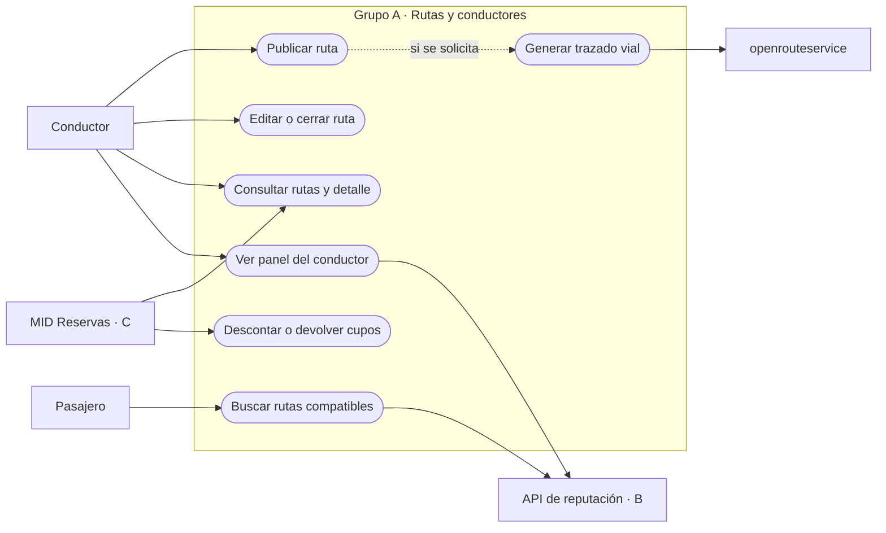
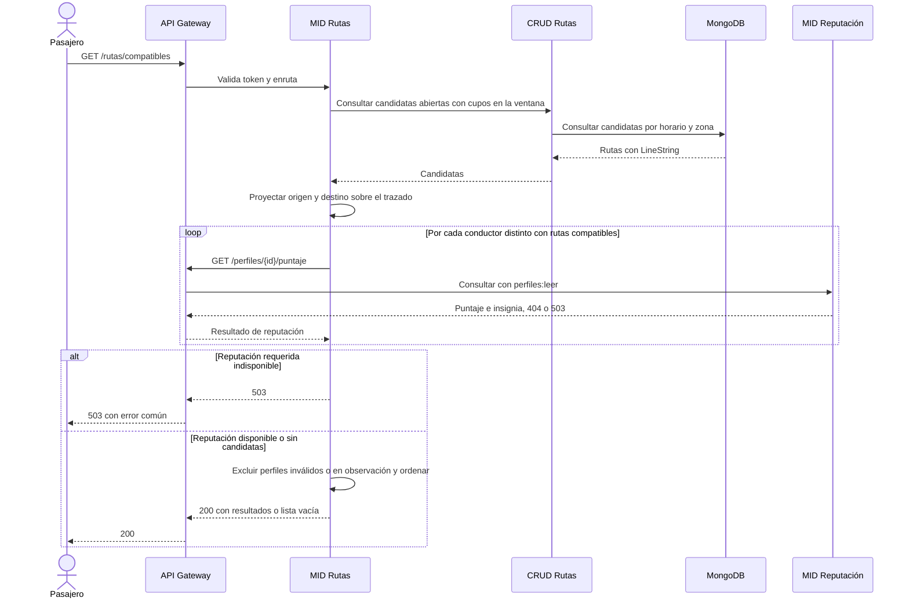
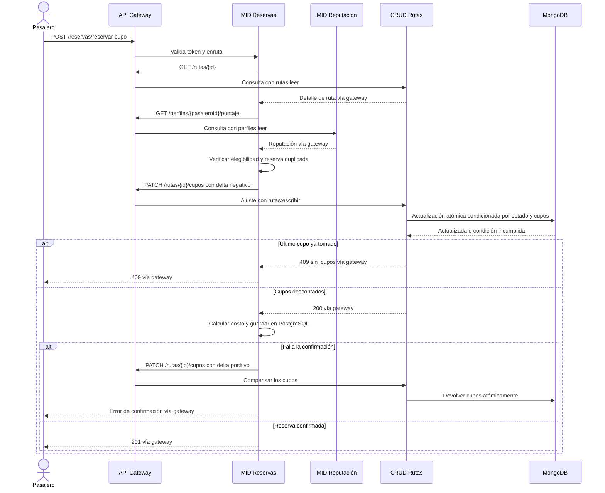

# Propuesta para el grupo A de Súbete · Rutas y conductores

El grupo A desarrollará `trip-forge` en **Go**, con **chi**, **MongoDB** y **JetBrains GoLand** como IDE del equipo. Publicará dos APIs, el CRUD de rutas y el MID de búsqueda y panel del conductor. La propuesta parte del escenario de tres grupos del enunciado. Si el clúster trabaja con dos, el servicio combinado de Reservas y reputación pasa a proveer el puntaje y a consumir rutas y cupos. [Enunciado del clúster](X1.cluster-subete.md)

## 1. Stack elegido

Go y chi permiten desplegar un binario por API. El equipo usará el cliente HTTP estándar con plazos y cancelación, el driver oficial de MongoDB al implementar persistencia y contratos OpenAPI versionados. GoLand abre el módulo desde la raíz y comparte las configuraciones de ejecución de `.run/`. La CLI de Go ejecuta las mismas pruebas en CI. El grupo A comunicará su elección al clúster para coordinar la diversidad tecnológica. [GoLand](https://www.jetbrains.com/go/) · [chi](https://github.com/go-chi/chi) · [Driver de MongoDB](https://www.mongodb.com/docs/drivers/go/current/)

MongoDB se ejecuta en Compose durante el desarrollo. Se usará una instancia administrada si el despliegue lo exige. Si el clúster elige **Cosmos DB con API de MongoDB**, prueben en la cuenta y versión concretas el índice sobre `LineString`, la consulta geográfica elegida y la actualización condicional de cupos antes de comprometerse con ese proveedor. Microsoft publica la compatibilidad por versión. [MongoDB 2dsphere](https://www.mongodb.com/docs/manual/core/indexes/index-types/geospatial/2dsphere/) · [Compatibilidad de Cosmos DB para MongoDB](https://learn.microsoft.com/en-us/azure/cosmos-db/mongodb/feature-support-70)

## 2. Casos de uso



| Caso | API propuesta | Resultado esperado |
| --- | --- | --- |
| Publicar ruta · R-HU1 | CRUD `POST /rutas` | Conductor autenticado. Valida salida futura, precio no negativo, 1 a 6 cupos y trazado válido de al menos dos puntos. Devuelve `201` o `400`. |
| Consultar rutas | CRUD `GET /rutas`, `GET /rutas/{id}` | Lista paginada con los filtros del enunciado. Detalle `200` o `404`. Reservas consulta el detalle con `rutas:leer`. |
| Editar o cerrar · R-HU3 | CRUD `PUT /rutas/{id}`, `DELETE /rutas/{id}` | El propietario edita su ruta o la cierra lógicamente. Cerrar con reservas confirmadas da `409`. |
| Ajustar disponibilidad · R-HU2 | CRUD `PATCH /rutas/{id}/cupos` | Reservas usa `rutas:escribir` y envía `delta` negativo o positivo. Guarda cupos y estado juntos. Si faltan cupos, devuelve `409 sin_cupos`. |
| Buscar rutas · R-HU4 y R-HU5 | MID `GET /rutas/compatibles` | Recibe origen, destino y ventana de salida. Filtra por cercanía, dirección e insignia. Devuelve `200` con rutas ordenadas o con lista vacía. Devuelve `503` si la reputación requerida está indisponible. |
| Ver panel · R-HU6 | MID `GET /conductores/{id}/panel` | Devuelve rutas del conductor, cupos ocupados, puntaje e insignia. Perfil inexistente da `404`. Perfil existente sin rutas da `200` con lista vacía. |

Los permisos de propietario se aplican usando la identidad autenticada del conductor. A debe acordar con el gateway los permisos de usuario para publicar, editar, cerrar y ver su panel, además de los scopes entre servicios ya definidos en el enunciado.

## 3. Dependencias entre APIs

| Llamada | Contrato | Manejo de fallos |
| --- | --- | --- |
| A → Gateway → B | `GET /perfiles/{id}/puntaje`, scope `perfiles:leer`. A consume `puntaje` e `insignia` para búsqueda y panel. | Timeout o `503` de B implica `503` cuando se necesita calcular la respuesta. Para búsqueda, se propone omitir candidatos cuyo perfil devuelve `404` y registrar la inconsistencia. En el panel se devuelve `404`. |
| C → Gateway → A | `GET /rutas/{id}` con `rutas:leer` y `PATCH /rutas/{id}/cupos` con `rutas:escribir`. | C interpreta los conflictos de cupos, crea la reserva tras descontar y devuelve los cupos si falla la confirmación. |
| B → Gateway → C | B obtiene el historial que usa para calcular el puntaje. | A depende indirectamente de C al consultar reputación. A puede cerrar rutas con el inventario local bajo el contrato de cupos descrito abajo. |
| A → openrouteservice | Generar un `LineString` vial al publicar con origen y destino. Propuesta de extensión al `POST /rutas` cuando el conductor solicita generación automática. | Aplicar timeout configurable, como máximo un reintento ante fallo transitorio dentro del plazo total y caché de trazados por coordenadas, waypoints y perfil. Ante caída sin caché, devolver `503` para generación automática. El cliente puede enviar un trazado válido en una nueva solicitud. |

Para ubicar la integración externa en el MID como muestra el enunciado, el CRUD recibe `POST /rutas` y llama a una operación interna del MID cuando se solicita la generación. El MID obtiene el trazado vial y lo devuelve al CRUD para validarlo y guardarlo. La operación de generación termina sin leer rutas del CRUD. Búsqueda y panel trabajan con lo ya almacenado. Confirmen este contrato interno con la rúbrica general, documenten degradación, timeouts y ejemplos en OpenAPI y simulen al proveedor en CI. [API de openrouteservice](https://giscience.github.io/openrouteservice/api-reference/endpoints/directions/)

## 4. Secuencias

### Buscar rutas compatibles



### Reservar y compensar cupos



## 5. Persistencia y reglas del MID

- **Documento de ruta.** Guardar `id`, `conductorId`, origen y destino como GeoJSON `Point`, `trazado` como GeoJSON `LineString`, salida UTC, precio, cupos totales y disponibles, y estado `abierta`, `llena` o `cerrada`. Usar coordenadas `[longitud, latitud]`, validar sus rangos y crear un índice `2dsphere` en `trazado`. Añadir índices para la ventana de salida y los listados por conductor según las consultas. [GeoJSON en MongoDB](https://www.mongodb.com/docs/manual/reference/geojson/)
- **Matching.** Preseleccionar rutas por estado, cupos y horario. Para la zona de la demo, usar el índice para prefiltrar por intersección con una región que cubra el radio de búsqueda de origen y probar que el filtro conserva todos los candidatos. El MID proyecta cada punto del pasajero sobre los **segmentos** del trazado, calcula la distancia en metros y mide el avance acumulado desde el comienzo de la línea. Ambos puntos deben quedar a menos de `RADIO_M` (800 m por defecto) y la posición del origen debe preceder a la del destino. La distancia devuelta aproxima la caminata mediante cercanía al trazado. [Operador geográfico de intersección](https://www.mongodb.com/docs/manual/reference/operator/query/geoIntersects/)
- **Ranking.** Consultar puntaje una vez por conductor por búsqueda, con concurrencia limitada. Excluir `en_observacion` y ordenar ascendentemente por `(distanciaOrigenM + distanciaDestinoM) / 100 - puntajeConductor * 2`. Usar el ID como desempate estable. El panel calcula ocupados como `cuposTotales - cuposDisponibles`.
- **Cupos y cierre.** Al descontar, exigir ruta abierta y disponibilidad suficiente en el filtro de escritura. Al devolver, exigir que la ruta esté abierta o llena y que la disponibilidad resultante quede dentro del total. Cambiar inventario y estado en la misma escritura atómica. Cerrar usando una condición de cero cupos comprometidos en el documento, con `409` si hay cupos descontados. Durante el intervalo entre descuento y confirmación, el cierre también queda bloqueado. Esto depende de que C mantenga el descuento de cada reserva confirmada y compense cada fallo o cancelación. Proteger del mismo modo las ediciones que rompan reservas existentes. [Atomicidad en MongoDB](https://www.mongodb.com/docs/manual/core/write-operations-atomicity/)
- **Acuerdos con C.** Mantener `delta` como pide el enunciado. Proponer además una clave de idempotencia por operación de descuento o devolución, vinculada a una reserva y su acción, para resolver reintentos tras un timeout. El resultado y el cambio de inventario deben persistir de forma indivisible. Acordar con C quién reconcilia una devolución fallida y usar la misma forma de medir la longitud del tramo para reproducir el costo de la demo.

## 6. Estructura prevista al completar las historias

```text
trip-forge/
├── cmd/
│   ├── rutas-crud/             # Entrypoint HTTP del CRUD
│   ├── rutas-mid/              # Entrypoint HTTP del MID
│   └── seed/                   # Carga reproducible de rutas de demo
├── internal/
│   ├── rutas/                  # Modelo, publicación, edición y cupos
│   ├── matching/               # Proyección, distancias y ranking
│   ├── mid/                    # Orquestación de búsqueda y panel
│   ├── httpapi/                # Rutas chi, DTO, autenticación y errores
│   ├── mongorutas/             # Consultas, índices y escrituras atómicas
│   └── clients/                # Clientes CRUD, MID, reputación y openrouteservice
├── api/
│   ├── rutas-crud.openapi.yaml
│   └── rutas-mid.openapi.yaml
├── test/integration/           # Mongo real y dependencias HTTP simuladas
├── .github/workflows/
├── .env.example
├── compose.yaml
├── go.mod
└── README.md
```

Usar un módulo Go con dos procesos para que cada API tenga su contrato y se pueda desplegar por separado. El CRUD es dueño de MongoDB y el MID accede a los datos mediante el CRUD. Acordar una operación interna de preselección segura por horario y zona, o comenzar paginando el listado de rutas abiertas en la ventana mientras el volumen sea el de la demo. Documentar el enrutamiento para que `/rutas/compatibles` llegue al MID y `/rutas/{id}` al CRUD. En GoLand, abrir la raíz del módulo y seleccionar las configuraciones compartidas de ejecución o pruebas. CI puede ejecutar los mismos comandos sin depender del IDE.

| Frente | Primer entregable |
| --- | --- |
| CRUD y datos | Modelo GeoJSON, índices, endpoints del CRUD, cierre lógico, script de concurrencia y 15 rutas semilla. |
| MID y geografía | Búsqueda, panel, cálculo geométrico y cliente de reputación con dobles de prueba. |
| Integraciones y entrega | Contratos OpenAPI, coordinación con gateway y B/C, proveedor externo, Compose, CI y ensayo de la demo. |

**Orden sugerido.** Primero acordar IDs, rutas HTTP, scopes, errores y datos semilla con los grupos consumidores. Luego hacer una entrega vertical con `POST /rutas`, `GET /rutas/{id}` y un descuento de cupos. Después implementar búsqueda, panel y generación vial. Cerrar con la prueba de dos solicitudes por el último cupo, rechazo por token y scope, geometría invertida, desempate por reputación, cierre con reserva activa y búsqueda con B apagado. El pipeline valida contratos y ejecuta pruebas en PR, y despliega al fusionar. Configurar URLs, credenciales, `RADIO_M` y plazos mediante variables de entorno, con `/health` y verificación de la cabecera del gateway según el enunciado.

## 7. Entorno y agentes del equipo

El [README](README.md) describe el arranque de las APIs y MongoDB. Las reglas compartidas de arquitectura y verificación están en [AGENTS.md](AGENTS.md).
